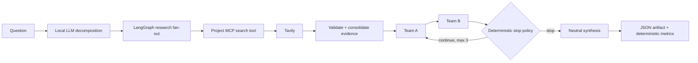

# Multi-Agent Debate

A local, evidence-grounded debate system for exploring contested questions.
LangGraph coordinates question decomposition, parallel web research, opposing
arguments, bounded rebuttal rounds, and a neutral synthesis. The project uses
an off-the-shelf local `qwen3:8b` model; the orchestration, MCP search boundary,
termination policy, evaluation, artifact validation, and UI are custom.

The default mode is deliberately small: shared research is collected once, two
one-shot agents debate for at most two rounds, and deterministic rules decide
whether another round is useful. A tested hierarchical-team design is retained
for comparison, but it is not the default because it cost more without improving
the project's frozen metrics in the recorded experiment.

## What it does

Given a question such as:

> Should governments provide universal basic income to all adult citizens?

the system:

1. classifies and, when useful, decomposes the question;
2. fans research queries out through a project-owned MCP `search_web` tool;
3. validates, deduplicates, and consolidates Tavily results into shared evidence;
4. runs opposing Team A and Team B arguments with bounded rebuttal rounds;
5. stops at the round limit or when both teams add little new content;
6. produces a neutral synthesis and a versioned JSON run record; and
7. calculates deterministic lexical and operational metrics.

A Streamlit interface exposes the same engine and adds one optional local-LLM
judge call after the debate. That judgment is advisory: it never controls graph
routing and is not treated as factual verification.

## Architecture



LangGraph orchestrates state transitions, parallel research workers, debate
turns, and synthesis. The LLM performs decomposition, argument generation, and
synthesis. Python code—not the LLM—validates state and schemas, consolidates
evidence, computes novelty, enforces the one-to-three-round bound, calculates
metrics and cost estimates, and protects secrets from published artifacts.

Research executes once per debate. Every turn sees the same evidence pool, so
later rounds test argument refinement rather than silently changing the facts.

## Requirements

- Python 3.12
- [Ollama](https://ollama.com/) with `qwen3:8b`
- A Tavily API key for live grounded runs

No external dataset or model weights are stored in this repository. The
committed `experiments/` records are small saved outputs used to support the
reported comparisons.

## Setup

```bash
git clone https://github.com/YairLutaty/multi-agent-debate.git
cd multi-agent-debate

python3.12 -m venv .venv
source .venv/bin/activate
python -m pip install --upgrade pip
python -m pip install -e '.[dev]'

ollama pull qwen3:8b
cp .env.example .env
```

Add your Tavily key to `.env`, then load it into the current shell:

```bash
set -a
source .env
set +a
```

`.env` and the real Streamlit secrets file are ignored by Git. The key is read
only when live dependencies are built; it is not accepted as a CLI argument,
placed in graph state, or written to run artifacts.

## Run the default debate

Start Ollama, then run:

```bash
python -m multi_agent_debate.app \
  --question "Should governments provide universal basic income to all adult citizens?" \
  --mode multi-round \
  --model qwen3:8b \
  --max-rounds 2 \
  --novelty-threshold 0.15 \
  --input-cost-per-million 0 \
  --output-cost-per-million 0 \
  --implementation-commit "$(git rev-parse HEAD)" \
  --output result.json \
  --score-output result.metrics-v1.0.json \
  --summary
```

`single-round` forces one exchange. `multi-round` supports one to three rounds
and defaults to two. Search is still performed only once.

The price arguments are explicit user-supplied estimates. A value of zero is a
local-compute placeholder; it does not mean that hardware, electricity, or
engineering time are free.

## Run the browser UI

```bash
export DEBATE_IMPLEMENTATION_COMMIT="$(git rev-parse HEAD)"
streamlit run src/multi_agent_debate/streamlit_app.py
```

The UI supports single-round, bounded multi-round, and the experimental
hierarchical mode. It displays debate rounds, sources, metrics, latency, token
telemetry, estimated cost, the advisory judge output, and a validated JSON
download. A judge failure does not discard the completed debate.

For persistent Streamlit configuration, copy
`.streamlit/secrets.toml.example` to `~/.streamlit/secrets.toml` and replace the
placeholder locally. Never commit the real file.

## Tests

The complete suite is offline and uses deterministic fakes or mocks at the
Ollama, MCP, HTTP, and Streamlit boundaries:

```bash
python -m pytest -q
```

Portfolio verification: **775 tests passed** with Python 3.12.1. This verifies
the application logic and boundaries; it is not a live Tavily or Ollama service
test.

## Recorded results

The main comparison used the same UBI question and local `qwen3:8b` model.
Metrics are frozen deterministic proxies; there is no weighted overall score.

| Metric | Grounded single round | Bounded two round |
| --- | ---: | ---: |
| Research utilization | 0.2291 | 0.3079 |
| Team novelty | 1.0000 | 0.3239 |
| Synthesis representation | 0.5414 | 0.7578 |
| Summary-policy compliance | 1 | 1 |
| Model calls | 4 | 6 |
| Latency | 64.47 s | 83.91 s |

The two-round run stopped at its configured maximum. Its six calls were one
decomposition, four argument turns, and one synthesis. These are individual
runs, not estimates of general performance or statistical significance.

A controlled replay held the question, decomposition, evidence, model settings,
synthesis, and metric version fixed while changing only the team architecture:

| Metric | One-shot teams | Hierarchical teams |
| --- | ---: | ---: |
| Research utilization | 0.2291 | 0.2204 |
| Team novelty | 1.0000 | 0.9739 |
| Synthesis representation | 0.5414 | 0.5195 |
| Summary-policy compliance | 1 | 1 |
| Model calls | 3 | 7 |
| Latency | 57.17 s | 152.70 s |

This result motivated the simpler one-shot teams as the default. Hierarchical
teams remain available as an inspectable experiment, not as a claimed general
improvement.

The exact run records, scorecards, hashes, and longer interpretations are in
[`docs/experiments.md`](docs/experiments.md). Metric definitions and edge cases
are in [`docs/evaluation.md`](docs/evaluation.md).

## Evaluation

Metric v1.0 is deterministic: saved output always receives the same score and
scoring never calls a model or external service.

- **Research utilization:** lexical coverage of each research finding in the
  team arguments or synthesis.
- **Team novelty:** one minus the three-token-shingle overlap between opposing
  arguments.
- **Synthesis representation:** coverage of both teams, penalized when one side
  is represented much more than the other.
- **Summary-policy compliance:** deterministic checks for prohibited verdict or
  winner language.

These metrics make architecture comparisons repeatable, but they do not measure
factual correctness, persuasiveness, reasoning quality, or source reliability.

## Repository map

- `src/multi_agent_debate/app.py` — grounded product CLI and dependency wiring
- `src/multi_agent_debate/multi_round_graph.py` — default bounded debate graph
- `src/multi_agent_debate/termination.py` — deterministic stop policy
- `src/multi_agent_debate/mcp_backend_search_server.py` — provider-neutral MCP tool
- `src/multi_agent_debate/tavily_search.py` — Tavily HTTP adapter and validation
- `src/multi_agent_debate/hierarchical_graph.py` — experimental specialist teams
- `src/multi_agent_debate/streamlit_app.py` — local browser interface
- `src/multi_agent_debate/judge.py` — optional advisory structured judge
- `src/multi_agent_debate/metrics.py` — frozen deterministic evaluation
- `experiments/` — saved run records, scorecards, and efficiency comparison
- `tests/` — deterministic offline regression suite

Some internal module and test names retain milestone labels because they preserve
the project's incremental experiment history. The map above identifies the
current product path.

## Limitations

- Tavily snippets are evidence candidates, not independently verified facts.
- Source-quality and citation-quality scoring are not implemented.
- The advisory LLM judge is subjective and is not a truth checker.
- The recorded experiments cover a small number of runs on one debate topic.
- Output may vary despite temperature `0.0` because local inference is not
  guaranteed to be bitwise deterministic.
- Historical artifacts predate complete token telemetry; missing usage is kept
  as unavailable rather than estimated.
- Latency measurements can be affected by warm-up, caching, execution order,
  and machine load.
- This is a local research application, not a production service: it has no
  authentication, durable database, hosted deployment, or distributed runtime.

No license is granted by this repository. Third-party packages and retrieved
web content remain subject to their respective terms.
